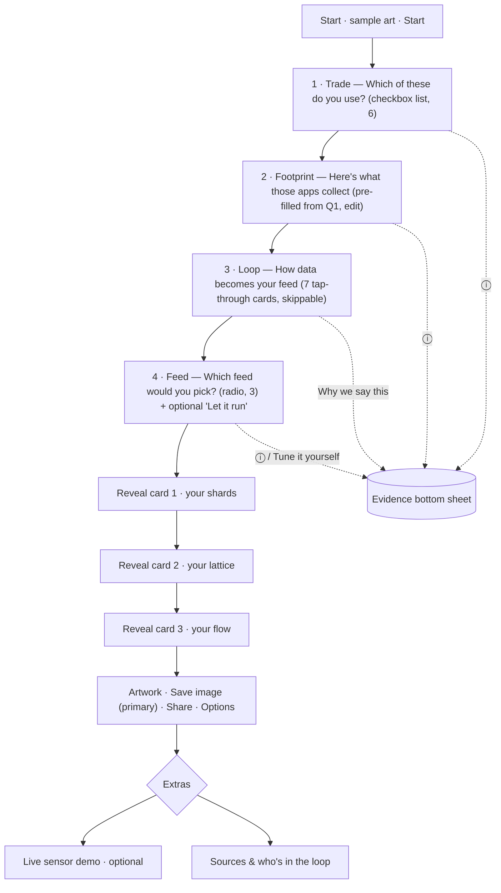

# Oracle Protocol v4 — Redesign & Refactor Plan

Status: **approved by the owner on 2026-11-17 with the recommended defaults for all five open decisions** (section 14). Being built on branch `oracle-v4`.
Written 2026-11-17 (Asia/Yerevan).
Measured against branch `ux-handover-wp0-6` @ `0aa162c` (PR #3, still OPEN, unmerged) served locally under `/oracle-protocol/`,
headless Chrome, 390×844 and 1280×860, Night and Day, `prefers-reduced-motion: reduce`.

Evidence files (kept outside the repo, on the build machine under `/workspace/oracle-qa/v4-plan/`):
- `shots/dark/*.png`, `shots/light/*.png` — every chapter, mobile + desktop, full page and first viewport (`qa/load.mjs`)
- `current-mobile-dark-sheet.png`, `current-mobile-light-sheet.png` — all mobile screens side by side
- `preview-reroll-evidence.png` — the live preview before and after ticking one trade
- `wireframes/*.png|svg` — low-fidelity v4 wireframes (`00-wireframes-sheet.png` shows all mobile frames)
- `load-dark.txt`, `load-light.txt`, `investigate.json` — raw measurements; `tools/` — the scripts used

---

## 1. Summary

v3 cut words by 62% and the site still feels complex, because the structure is a **long scrolling form with
side-quests**, not a guided build. Visitors make 14 yes/no decisions on two near-identical checklists before
anything interesting happens, chapter 03 asks nothing at all, chapter 04 is a 2-viewport dashboard, and — the
finding that matters most — **the live artwork preview re-rolls almost completely on every tick** (43% of pixels
change when one trade is ticked), so the promise "each choice shapes your artwork" is not visible.

**Proposed direction:** one question per screen, five screens, the artwork always on screen above the question,
each answer adding one recognisable layer to it, ending in a Wrapped-style three-card reveal. Evidence moves from
inline folds into a single, user-opened bottom sheet. The code is refactored into a small screen/state/component
core so the flow is data-driven and testable.

## 2. What was measured (current newest version)

Identical in Night and Day (layout does not change with scheme). 390×844, nothing opened.

| Screen | Visible words | Controls | Required decisions | Page length (viewports) | Font sizes | Badges/labels | Reading grade (FK, approx.) |
|---|---|---|---|---|---|---|---|
| 00 Start | 47 | 1 | 1 (Begin) | 1.0 | 5 | 0 | 6.2 |
| 01 Trade | 90 | 13 | 6 yes/no | 1.2 | 5 | 0 | 12.2* |
| 02 Footprint | 127 | 19 | 8 yes/no + a 3-term taxonomy to read | 1.8 | 6 | 3 | 8.3 |
| 03 Loop | 103 | 9 | 0 (read-only, 7 chevrons) | 1.5 | 6 | 0 | 8.8 |
| 04 Feed | 215 | 11 | 1 of 3, plus Run / Reset | 2.0 | 6 | 3 | 10.8 |
| 05 Artwork | 99 | 9 | 2 actions, 6 edit links | 1.5 | 5 | 0 | 14.0 |
| 02b Sensor demo | 56 | 16 | 11 tiles + 2 buttons | 1.4 | 5 (min 10 px) | 11 | — |

*Grade inflated by "Give X · get Y" fragments without full stops. Desktop (1280) has the same words and controls;
02 is 1.7 and 04 is 2.0 viewports long. Total visible words in the main path: **681** (≈ 2.9 min of reading at
238 wpm before any interaction). Minimum taps to reach the artwork: 5; typical: 20+ (6 + 8 ticks, preset, rounds).

**Live-preview test** (`tools/diff.mjs`): pixels changed in the 96×120 px preview after one input — tick 1 trade
**43%**, tick 6th trade 45%, tick 1 footprint category 47%, pick "Most engaging" 54%, run a round 56%. Root
cause: `compose()` seeds its single PRNG from `canonical(all params)` (`art/oracle-art.js:156`), so any change
reshuffles every layer. The caption says "added a red shard"; the picture says "everything changed".

**Preview visibility:** on 02 the last checkbox sits at y 1225, the preview at y 244 — you cannot see the art while
ticking most of the list. On 03 there is no preview at all.

## 3. Problems, ranked by severity

| # | Severity | Problem | Evidence |
|---|---|---|---|
| P1 | Critical | **Choice → art link is invisible.** Each input re-rolls the whole composition; the preview is 96×120 px. | 43–56% pixel change per input; `rngFor(canonical(n))`; `preview-reroll-evidence.png` |
| P2 | Critical | **Two back-to-back checklists (14 yes/no) with overlapping meaning.** "Social platforms" vs "Identity / Social relationships"; feels like a form. | 01: 6 boxes, 02: 8 boxes, 19 controls on 02 |
| P3 | High | **Every screen is still a scrolling page with several jobs.** 02 = taxonomy + evidence + checklist + demo link; 04 = note + presets + 10-row table + 2 buttons + 2 folds + evidence panel. | 02: 1.8 vp, 04: 2.0 vp, 215 words |
| P4 | High | **03 Loop is passive.** No question, 7 chevrons, jargon ("propensities", "candidate generation", "SDKs", "attention allocation"). Hick-free but engagement-free. | 0 decisions, FK 8.8, ease 48 |
| P5 | High | **Jargon and internal parameter names leak into the payoff.** Legend reads "social proof 60", "emotion 75, relevance 60", "repetition 50" — dials the visitor never saw. Poster text says "exchanges surrendered" (old vocabulary). "seed and dial values". | 05 FK 14.0; 7 jargon terms visible |
| P6 | Medium | **Feed mechanics are unclear.** "Rounds", "Run a round", "Reset rounds", percentages to one decimal across 10 rows; result sentence competes with table. | 217 words; 10 rows × % |
| P7 | Medium | **Inconsistent visual language.** Sensor demo uses emoji tiles, 10 px uppercase, 25 caps labels, different buttons; reachable from step 2 mid-flow. | 02b: 25 caps, min 10 px |
| P8 | Medium | **Too many disclosure patterns** — `<details>` folds, row chevrons, "More evidence", "Options", "Model rules", "Adjust the ranker", Sources drawer. Seven ways to "see more". | 02: 10 disclosures |
| P9 | Medium | **No Back, no sense of length.** Forward-only Next; progress only in the top pill. Nielsen #3 (user control). | PLAN §5b rule 3 |
| P10 | Low | **Chrome on every screen** — Sources + theme select footer repeat on all screens and compete with the CTA on phones. | footer on 00–05 |
| P11 | Low | **Desktop wastes the width** — a 600 px column with 300 px gutters; the art and controls stack instead of sitting side by side. | 04 desktop 2.0 vp |

### Heuristic review (Nielsen's 10, Hick, progressive disclosure, one task per screen)

| Heuristic | Verdict | Where |
|---|---|---|
| 1 Visibility of system status | Fails | preview re-rolls (P1); no visible "how many questions left" in-page |
| 2 Match with the real world | Partial | "Trade", "lattice", "shard", "rounds", "seed" are author vocabulary |
| 3 User control & freedom | Fails | no Back; edits only from 05 |
| 4 Consistency & standards | Partial | 7 disclosure patterns; sensor demo looks like another product |
| 5 Error prevention | OK | nothing destructive |
| 6 Recognition over recall | Fails on 05 | legend cites slider values the visitor never set |
| 7 Flexibility | OK | presets + raw sliders exist |
| 8 Aesthetic & minimalist | Partial | 04 and 02 carry secondary content inline |
| 9 Error recovery | n/a | — |
| 10 Help & documentation | OK but scattered | evidence in folds, drawer and panels |
| Hick's law | Fails on 01/02 | 6 + 8 binary choices presented at once ×2 |
| Progressive disclosure | Over-used | > 2 levels (fold inside panel inside chapter) — NN/g warns beyond 2 levels users get lost |
| One task per screen | Fails on 02, 04, 05 | see P3 |

### Where a first-time visitor gets confused (walkthrough)

- **Start:** clear. "ORACLE / THE ANATOMY OF ATTENTION" + a verse = three voices before the CTA.
- **Trade:** "Give identity and activity · get connection" — is this about me or about the apps? Ticking changes the
  tiny picture entirely; did I do that?
- **Footprint:** reads a definition (Recorded/Guessed/Hidden) before knowing why; then 8 more boxes that repeat
  01; "IP-derived", "dwell time", "metadata". The art preview scrolls away. "Live sensor demo (optional)" — should I?
- **Loop:** nothing to do; seven rows look like settings that should open; next step is a link-styled "Who is in this loop?".
- **Feed:** "SIMULATED" badge first; presets labelled by what they are, not what I'd want; ten percentages; what is a round?
- **Artwork:** good moment, then a legend of internal numbers. "Link and file hold only the seed and dial values".

## 4. How known products handle the same shape (public sources)

| Product | Pattern we borrow | Source |
|---|---|---|
| Typeform | One question at a time; conversational; progress; big tap targets. Typeform's own research: forms with > 6 questions complete < 50% of the time. | typeform.com/blog/series-b ; typeform.com/blog/interactive-form-boost-conversions ; smashingmagazine.com/2014/09/sci-fi-frustrations-flash-and-forms-the-typeform-story/ |
| Duolingo | Value before commitment: moving sign-up after the first lesson gave about +20% DAU. → Show the art from the first answer. | review.firstround.com/the-tenets-of-a-b-testing-from-duolingos-master-growth-hacker/ |
| Spotify Wrapped | Full-screen story cards, one data point per card, a share button on each, reduced-motion version. → three-card reveal. | alexandriagoree.com/spotify-wrapped (Spotify product designer) ; newsroom.spotify.com/2023-11-29/wrapped-design-marketing-brand-creative-inside-spotify/ |
| Apple App Store privacy labels | Plain three-way grouping ("Data used to track you / linked to you / not linked to you") with plain data-type names. → plain footprint groups. | theverge.com/2020/12/14/22174017/apple-app-store-new-privacy-labels-ios-apps-public |
| Apple HIG sheets | Resizable bottom sheets with a grabber for progressive disclosure on iPhone. → evidence sheet. | developer.apple.com/design/human-interface-guidelines/sheets |
| NN/g | Progressive vs staged disclosure; > 2 levels loses users; wizards suit infrequent, novice tasks. | nngroup.com/articles/progressive-disclosure/ ; nngroup.com/articles/wizards/ |
| Laws of UX | Hick's law: break complex tasks into smaller steps; highlight recommended options. | lawsofux.com/hicks-law/ |
| GuidedTrack | One question per page → no scrolling, larger targets, faster completion. | docs.guidedtrack.com/research-guide/building-user-friendly-surveys/one-question-per-page/ |

## 5. Design principles for v4

1. **The artwork is the progress bar.** It is on screen during every question, and each answer adds one layer you can point at.
2. **One question per screen, one viewport per screen** at 390×844. If it does not fit, it does not belong.
3. **Answer first, explain on request.** Evidence lives in one bottom sheet opened by an ⓘ; nothing explanatory sits above a question.
4. **Plain words, one meaning.** No engine vocabulary (seed, dial, lattice, round) on primary surfaces; provenance badges only inside the sheet.
5. **Recommend, don't require.** Pre-fill sensible answers (derived footprint, a recommended feed) so "Next" always works.
6. **Calm motion.** Each change animates once (≤ 400 ms) and settles; reduced motion = instant.
7. **Same honesty.** Every claim keeps its VERIFIED / INFERRED / SIMULATED / UNKNOWN label and source; derived guesses are labelled as our assumption.

## 6. Information architecture & flow

Five screens + reveal. Chapters keep their route ids (`#offer`, `#extraction`, `#machine`, `#loop`, `#revelation`) so old links work.



Persistent frame on every question screen (in page flow, never fixed over content):
`‹ Back · 5-segment progress · "2 of 5"` → **artwork stage** (≈ 30–40% of the viewport) → one-line caption
(aria-live) → **question** → answers → **one primary button** at the bottom of the viewport.
Desktop: art left (≈ 50%), question right, both in one viewport.

## 7. Per-screen redesign

| Screen | Purpose | The one question | Controls | Copy limit | Removed / folded |
|---|---|---|---|---|---|
| 00 Start | Promise + time + privacy | — | 1 button | ≤ 30 words | verse → footer/credits; "Anatomy of attention" subtitle merged into title |
| 1 Trade | Your inputs | "Which of these do you use?" | 6 checkbox rows (icon + 2–4 word label), ⓘ per row → sheet, Next | ≤ 45 words | "Give · get" lines → sheet; tally bar (the art is the tally) |
| 2 Footprint | What that gives away | "Here's what those apps collect — fix anything" | 8 checkbox rows **pre-ticked** from Q1, "from Social apps" sub-label, Next | ≤ 50 words | Recorded/Guessed/Hidden taxonomy → one line + sheet; sensor demo link → Extras |
| 3 Loop | How it works | "How does your data become your feed?" | 7 cards, one per step, Next step / Skip; ring lights node n | ≤ 20 words per card | 7-row list, chevrons; "Who is in this loop?" → Extras |
| 4 Feed | Feel the ranker | "Which feed would you pick?" | 3 radio cards with 1-line meaning; result = 1 sentence + top 3 bars; one "Let it run" button (animates 4 rounds once); "Tune it yourself" → sheet with 6 sliders | ≤ 60 words | 10-row table (→ sheet), Reset, Model rules, Gini, metric %, SIMULATED badge → one inline "toy model" tag |
| Reveal ×3 | Payoff, explained | — | tap/next, Change › link per card | ≤ 12 words per card | the legend of raw numbers |
| 5 Artwork | Keep & share | — | Save image (primary), Share, Options sheet, Start over | ≤ 25 words | look line, seed, history, format buttons → Options |
| Evidence sheet | Depth on demand | — | native `<dialog>`, grabber, Close, Esc | free | replaces 7 disclosure patterns + Sources drawer |

## 8. Component system

| Component | Use | Notes |
|---|---|---|
| `ScreenFrame` | every question screen | Back, progress, art stage, caption, question, answers, CTA; enforces one viewport via CSS grid `min-height: 100svh` |
| `ProgressSegments` | top of frame | 5 segments + "n of 5"; `aria-valuenow` |
| `ArtStage` | top of frame | the real renderer at stage size; highlights the layer the last answer touched |
| `CheckList` | Trade, Footprint | native `<input type=checkbox>` rows, full-row label, 52 px tall, optional sub-label and ⓘ |
| `RadioCards` | Feed | native radio group in `<fieldset>`, card with title + one line, selected border |
| `StoryCards` | Loop, Reveal | one card at a time, dots, Next/Skip, arrow keys, swipe optional |
| `Sheet` | evidence, tune, options, sources | native `<dialog>` (focus trap & Esc built in), slides from bottom on phones, side panel on desktop |
| `PrimaryButton` | one per screen | full-width on phone, at the bottom of the viewport **in flow** |
| `Badge` | inside Sheet only | VERIFIED / INFERRED / SIMULATED / UNKNOWN |

## 9. Visual & typography simplification

- Type: 4 sizes per screen (question 22/30, body 16, label 14, caption 12); one display face for questions, one text face; mono only in badges.
- Uppercase only in badges. No kicker ("STEP 2 OF 5" duplicated the progress).
- Colour: neutral surfaces; one accent for selection/primary; red reserved for shards; provenance colours only in the sheet.
- Cards: 12 px radius, no hairline boxes around every group; spacing does the grouping.
- Footer (Sources, theme) only on Start and Artwork; theme follows the OS by default.
- Sensor demo restyled to the same tokens if kept.

## 10. Code refactor plan

Constraints kept: vanilla classic scripts, no build, CSP `script-src 'self'`, `connect-src 'none'`, self-hosted fonts.

```
index.html
core/state.js      single store {schema, seed, answers:{trades, footprint, feed, rounds, tune}}, reducer, subscribe,
                   hash <-> state (#art?... unchanged), localStorage
core/router.js     SCREENS = [{id, route, render, canNext}] — order and progress come from this list
core/sheet.js      <dialog> controller
ui/components.js   CheckList, RadioCards, StoryCards, ProgressSegments, ArtStage, Button (template + event delegation)
screens/start.js trade.js footprint.js loop.js feed.js reveal.js artwork.js
content/*.js       copy per screen with word budgets; evidence.js unchanged
art/oracle-art.js  v1 unchanged (old links, reference PNG byte-identical)
art/layers.js      v2 composer: base from seed only; one RNG stream per layer (seed+layer); answers only modulate their layer
extras/sensors/    the v1.2 demo (app-core/ui/vitals), loaded only on #sensors
css/tokens.css base.css components.css screens.css   (styles.css v1.2 remnants retired)
```

Tests:
- Unit (node): reducer, hash round-trip, footprint-from-trades mapping, v1 hash fixtures unchanged, **v2 layer stability**
  (toggling one trade changes only the shard layer; pixel diff of the rest = 0), content word budgets, every claim has a label + source.
- E2E (`qa.mjs` rewritten as per-screen specs — done as `qa/v4.mjs`; `qa.mjs` retired in WP10, mapping in QA.md): one-viewport check at 390×844, one primary per screen, Back/Next, sheet focus/Esc, no network, reduced motion, determinism.
- `load.mjs` extended: decisions per screen, art-in-view while answering, scripted time-to-finish.
- axe WCAG 2.1 AA and contrast in all 6 looks, both schemes.

## 11. Success targets (390×844 unless noted)

| Measure | Now (worst) | v4 target |
|---|---|---|
| Visible words per question screen | 215 (Feed) | ≤ 60 |
| Visible words, whole path | 681 | ≤ 350 |
| Required decisions per screen | 8 + reading | ≤ 1 question |
| Options shown at once | 8 | ≤ 7 |
| Controls per screen | 19 | ≤ 10 |
| Page length | 2.0 viewports | 1.0 (no scroll) on every question screen |
| Art visible while answering | 01 only | 100% of question screens |
| Preview change per single input | 43–56% of pixels, whole picture | only the touched layer changes; 0% change in the other layers |
| Font sizes per screen | 6 | ≤ 4 |
| Taps to the artwork (fast path) | 5 + scrolling | ≤ 7, no scrolling |
| Scripted time to finish (est., 238 wpm + 1 s/decision) | ≈ 3–3.5 min (estimate) | ≤ 2 min |
| axe violations / contrast | 0 / ≥ 4.5 | 0 / ≥ 4.5 in 6 looks |
| Outbound requests | 0 | 0 |
| v1 reference PNG `ORACLE-7K3F-Q9ZD` | identical | identical |

Plus a qualitative bar: a first-time visitor on a phone can say on each screen what it's for and point at what their answer changed (5-person hallway test, if the owner can run one).

## 12. Work packages (one commit each, new branch off the approved base)

| WP | Scope | Effort |
|---|---|---|
| 0 | Baseline + spec freeze (this plan's numbers, screenshots) | S (½ day) |
| 1 | Core: state/router/sheet/components, existing screens ported 1:1 (no visual change) | L (1½ days) |
| 2 | Layered art composer v2 + stability tests; v1 kept for old links | L (1½ days) |
| 3 | ScreenFrame, progress, Back, one-viewport layout, desktop two-column | M (1 day) |
| 4 | Trade + Footprint screens (derived footprint, sheet evidence) | M (1 day) |
| 5 | Loop story cards | S–M (¾ day) |
| 6 | Feed radio cards + Let it run + Tune sheet | M (1 day) |
| 7 | Reveal cards + Artwork (Save/Share/Options) | M (1 day) |
| 8 | Visual + type pass, both schemes, 6 looks | S–M (¾ day) |
| 9 | Extras (sensor demo restyle/relocate, Sources), remove simulator + v1.2 remnants, docs | M (1 day) |
| 10 | QA rewrite, load table before/after, axe, contrast, PR | S–M (¾ day) |

≈ 10–11 working days of agent time; WP1–4 alone deliver most of the felt change.

## 13. Risks

| Risk | Mitigation |
|---|---|
| New art engine changes how artworks look | v2 only for new compositions; v1 links/PNG stay byte-identical; `v=` in the hash picks the engine |
| Derived footprint reads as a factual claim | labelled "our guess from your apps (an assumption)"; mapping table in sources, editable |
| Shortened copy distorts evidence | claims move verbatim into the sheet; only framing is cut; content test checks every claim keeps label + source |
| Bottom sheet feels like "UI over content" (owner objected to floating bars in v3) | it opens only when tapped, dims the page, closes on Esc/tap-outside; no persistent overlay; decision D4 |
| One-viewport rule fails on small phones (≤ 667 px tall) | art stage shrinks first (min 120 px), then answers scroll inside the frame; test at 375×667 |
| QA rewrite hides regressions | privacy, determinism, axe and contrast checks are ported first and never weakened |
| Safari / Firefox / real phones untested | `<dialog>` is supported since Safari 15.4; ask owner for one real-phone pass before merge |

## 14. Open decisions (recommended default first)

1. **Merge Trade and Footprint by pre-filling Footprint from Trade answers?** Default: **Yes** (cuts 8 required decisions to 0; labelled as an assumption). Alternative: keep two separate checklists.
2. **Layered art engine v2 so each answer adds a visible layer?** Default: **Yes**, for new compositions only; v1 stays for old links and the reference PNG. Alternative: keep v1 and only enlarge the preview (link stays weak).
3. **Loop chapter format?** Default: **7 tap-through cards with Skip**. Alternatives: one card with the ring + sheet (shortest), or cut the chapter and move it to Extras.
4. **Allow a user-opened bottom sheet for evidence and a Back button?** Default: **Yes to both**; still no persistent fixed or sticky chrome, the primary button stays in page flow. Alternative: keep inline folds and forward-only Next.
5. **Sensor demo and exchange simulator?** Default: **move the sensor demo to Extras after the artwork (restyled), delete the hidden simulator code** (it stays in git history). Alternative: keep both as they are.
