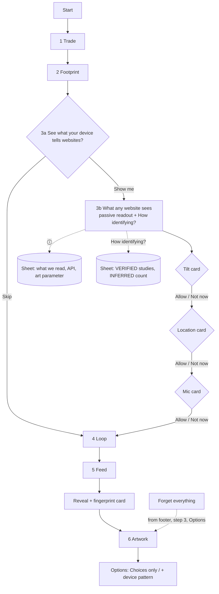

# Oracle Protocol v5 — Device Footprint Plan

> **Status: approved 2026-11-18 (Asia/Yerevan)** — "Approved, start v5 with the recommended defaults and the new privacy
> rule". Built on branch `oracle-v5` off `oracle-v4` @ bfce77a, one commit per work package (§12). Defaults D1–D5 (§15)
> are used exactly as written. Where this plan is silent on a material choice, the build takes the most conservative
> option and records it in §18 below. Plan page: https://cursor.com/canvas/store-c0a4656f-1ead-4227-8e9a-975a1b4c19c1/4bf5c93d-c0e1-48e8-bc1b-90267f103bd9

Status: **proposal for approval. No code changed, nothing pushed.** Audited 18 Nov 2026 (Asia/Yerevan, UTC+4) on
`oracle-v4` @ bfce77a (PR #4, open, not merged; prod = 4526203).

## 1. Inventory: every device signal Oracle has ever read

Versions audited from git history: v1.1 (8e889a6, 27 Aug 2026), v1.2 (7f1f3a6, 4 Sep), v2 (19307ff), v3 (13733c4,
= prod 4526203 code), PR #3 (0aa162c), v4 (bfce77a). Line numbers point at the reading line in each version
(`app-core`, `app-vitals`, `theme-boot` are the `.js` files). "—" means the version did not have it.

**36 signals.** v1.1 read 28 of them (identity, location, camera, mic, battery and the device profile). v1.2 added 7 (tilt,
shake, WebGPU, JS heap, storage quota, CPU speed index, Bluetooth) plus a permissions query and the motion permission flow. v2 added the
colour-scheme/motion preferences for theming. **Nothing was ever deleted**: all 35 sensor/fingerprint readers are still in
v4's code. In v4 they run **only** inside the optional Extras → Sensor demo and identity step, each on a tap, and **none
feeds the artwork**. The five-step journey touches only `devicePixelRatio` (to size the canvas), the viewport (layout) and
the colour-scheme preference (theme).

Runtime check (headless Chrome 156.0.8078.47, every API wrapped before page scripts ran, script
`/workspace/oracle-qa/v5-plan/api-probe.mjs`, results `api-probe.json`):

| Path | Device APIs actually called |
|---|---|
| Journey: Start → Trade → Footprint → all 7 Loop cards → Feed + Let it run → all 5 Reveal cards → Artwork → Save image → Options → Extras | `devicePixelRatio` only |
| Extras → Sensor demo, every row tapped, location/camera/mic/motion granted | each row calls exactly its own APIs (table above); Device profile row calls 30 |
| Identity: anonymous ID / passkey (virtual authenticator) | `window.ethereum` probe; `isUVPAA` + `credentials.create` |
| Identity with a stub wallet | `eth_requestAccounts`, `eth_chainId`, `eth_getBalance` |
| Outbound requests in all runs | 0 |

Badges seen in the headless run: location OK (40.18000, 44.51000), tilt and shake UNAVAILABLE (no sensor), GPU OK (ANGLE /
Vulkan), CPU OK (8 cores · 16 GB), Bluetooth UNAVAILABLE (API absent on Linux), camera OK 640×480 (fake), mic OK, battery
OK, network OK, device profile OK.

Findings beyond the table:
- `getGeo` (app-core:320 in v4) is dead code: `harvestGeo` in app-vitals replaced it in v1.2.
- No screen-orientation lock was ever used (a grep hit on `lock(` is `tickClock(`).
- The microphone row labels average spectrum energy as "hz avg": a mislabel.
- The wallet path reads an ETH balance; the wallet extension fetches it from its own RPC node, outside our CSP.
- Location is shown to 5 decimals (about 1 m), more than any artwork needs.
- Chrome 156 exposes `DeviceOrientationEvent.requestPermission` (Chrome 152+), so the old "iOS only" assumption no longer holds.

| # | Signal | API | Prompt? | What it read | v1.1 | v1.2 | v2 | v3 | PR #3 | v4 | Chrome | Safari iOS | Firefox | Brave | v4 status (runtime-verified) |
|---|---|---|---|---|---|---|---|---|---|---|---|---|---|---|---|
| 1 | Passkey | WebAuthn `navigator.credentials.create`, `isUserVerifyingPlatformAuthenticatorAvailable` | Prompt (OS biometric/PIN sheet) | Creates a throwaway credential; shows type, transports, first 24 chars of the credential id | app-core:241 | app-core:241 | app-core:285 | app-core:292 | app-core:303 | app-core:299 | Yes | Yes | Yes | Check on device: Brave lists "Disable navigator.credentials" among removed Chromium features | Optional Extras → identity step; called on tap (verified) |
| 2 | Crypto wallet | EIP-1193 `window.ethereum.request` (`eth_requestAccounts`, `eth_chainId`, `eth_getBalance`) | Prompt (wallet extension) | Address, chain id, ETH balance. Without a wallet: a random throwaway address | app-core:213 | app-core:213 | app-core:257 | app-core:264 | app-core:275 | app-core:271 | With an extension | No (wallet in-app browsers only) | With an extension | Brave Wallet injects a provider | Optional Extras → identity step; 3 calls on tap with a stub wallet (verified) |
| 3 | Geolocation | `geolocation.getCurrentPosition` (high accuracy) + `permissions.query` | Prompt | Latitude/longitude to 5 decimals, accuracy, altitude, heading, speed | app-core:263 | app-core:263, app-vitals:34 | app-core:307, app-vitals:35 | app-core:314, app-vitals:35 | app-core:325, app-vitals:35 | app-core:321, app-vitals:35 | Yes | Yes | Yes | Yes (prompt) | Extras sensor demo, on tap (verified) |
| 4 | Camera | `mediaDevices.getUserMedia({video})` | Prompt | Resolution, frame rate, facing mode, start of the device label; stream stopped at once | app-core:280 | app-core:280 | app-core:324 | app-core:331 | app-core:342 | app-core:338 | Yes | Yes | Yes | Yes; device list randomised | Extras sensor demo, on tap (verified, fake camera) |
| 5 | Microphone | `getUserMedia({audio})` + `AudioContext` analyser | Prompt | Average spectrum energy over 0.5 s (shown as "hz avg", which is a mislabel), sample rate | app-core:290 | app-core:290 | app-core:334 | app-core:341 | app-core:352 | app-core:348 | Yes | Yes | Yes | Yes; audio readback randomised | Extras sensor demo, on tap (verified, fake mic) |
| 6 | Battery | `navigator.getBattery()` | Passive | Level, charging, charge/discharge time | app-core:273 | app-core:273 | app-core:317 | app-core:324 | app-core:335 | app-core:331 | Yes | No | No (removed in 52) | Disabled: returns a fixed value | Extras sensor demo, on tap (verified) |
| 7 | Device tilt | `deviceorientation` events, `DeviceOrientationEvent.requestPermission` | Prompt on iOS and Chrome 152+; passive on older Android | alpha/beta/gamma, absolute flag, screen orientation | — | app-vitals:70 | app-vitals:71 | app-vitals:71 | app-vitals:71 | app-vitals:71 | Android: yes. Desktop: no sensor | Yes, after a tap-triggered permission | Android: yes | Check on device: Brave lists "Disable Motion Sensors" | Extras sensor demo, on tap (verified: permission asked, listeners attached) |
| 8 | Shake / gravity | `devicemotion` (`accelerationIncludingGravity`) | Same as tilt | Acceleration magnitude, shake peak count | — | app-vitals:79 | app-vitals:82 | app-vitals:82 | app-vitals:82 | app-vitals:82 | Android: yes | Yes, after permission | Android: yes | Check on device | Extras sensor demo, on tap (verified) |
| 9 | WebGL renderer | `WEBGL_debug_renderer_info` (unmasked vendor/renderer), extension count, max texture | Passive | GPU model string, vendor, extensions, max texture size | app-core:115 | app-core:115 | app-core:159 | app-core:166 | app-core:177 | app-core:173 | Full string | Generic ("Apple GPU") | Generalised | Generic string; extension list randomised | Extras: GPU and Device profile rows (verified) |
| 10 | WebGPU adapter | `navigator.gpu.requestAdapter()` → `adapter.info` | Passive | Adapter device/description | — | app-vitals:120 | app-vitals:133 | app-vitals:133 | app-vitals:133 | app-vitals:133 | 113+ (Linux partial) | iOS 26+ | Windows 141+, Apple-silicon macOS 145+; not Linux/Android | Adapter details emptied | Extras: GPU row (verified) |
| 11 | CPU cores | `navigator.hardwareConcurrency` | Passive | Logical core count | app-core:164 | app-core:164, app-vitals:146 | app-core:208, app-vitals:159 | app-core:215, app-vitals:159 | app-core:226, app-vitals:159 | app-core:222, app-vitals:159 | Yes | Yes | Yes | Randomised | Extras: CPU and Device profile rows (verified) |
| 12 | Device memory | `navigator.deviceMemory` | Passive | RAM bucket in GB | app-core:165 | app-core:165, app-vitals:147 | app-core:209, app-vitals:160 | app-core:216, app-vitals:160 | app-core:227, app-vitals:160 | app-core:223, app-vitals:160 | Yes | No | No | Randomised | Extras (verified) |
| 13 | JS heap | `performance.memory` (non-standard) | Passive | Used/total/limit MB | — | app-vitals:131 | app-vitals:144 | app-vitals:144 | app-vitals:144 | app-vitals:144 | Yes | No | No | Chromium value | Extras: CPU row (verified) |
| 14 | Storage quota | `navigator.storage.estimate()` | Passive | Quota in GB | — | app-vitals:141 | app-vitals:154 | app-vitals:154 | app-vitals:154 | app-vitals:154 | Yes | Yes | Yes | Fixed value | Extras: CPU row (verified) |
| 15 | CPU speed index | Busy loop timed with `performance.now()` for 24 ms | Passive | Loop count ÷ 1000 | — | app-vitals:130 | app-vitals:143 | app-vitals:143 | app-vitals:143 | app-vitals:143 | Yes | Yes (coarser timer) | Yes (coarser timer) | Yes | Extras: CPU row (verified) |
| 16 | Bluetooth | `navigator.bluetooth.getAvailability()` | Passive (adapter on/off only) | Whether the radio is on | — | app-vitals:157 | app-vitals:170 | app-vitals:170 | app-vitals:170 | app-vitals:170 | Desktop and Android; Linux behind a flag | No | No | Disabled | Extras row; reads "UNAVAILABLE" in the headless Linux test because the API is absent |
| 17 | Network information | `navigator.connection` (effectiveType, downlink, rtt, saveData) | Passive | Connection class, Mb/s estimate, round trip, data saver | app-core:199 | app-core:199 | app-core:243 | app-core:250 | app-core:261 | app-core:257 | Yes | No | No | Disabled | Extras: Network and Device profile rows (verified) |
| 18 | Online status | `navigator.onLine` | Passive | Online or offline | app-core:163 | app-core:163, app-vitals:171 | app-core:207, app-vitals:184 | app-core:214, app-vitals:184 | app-core:225, app-vitals:184 | app-core:221, app-vitals:184 | Yes | Yes | Yes | Yes | Extras (verified) |
| 19 | User agent | `navigator.userAgent` | Passive | Full UA string | app-core:157 | app-core:157 | app-core:201 | app-core:208 | app-core:219 | app-core:215 | Reduced UA | Yes | Yes | Randomised | Extras: Device profile (verified) |
| 20 | Platform | `navigator.platform` | Passive | OS platform string | app-core:158 | app-core:158 | app-core:202 | app-core:209 | app-core:220 | app-core:216 | Yes | Yes | Yes | Yes | Extras: Device profile (verified) |
| 21 | Languages | `navigator.language`, `languages` | Passive | Preferred language list | app-core:160 | app-core:160 | app-core:204 | app-core:211 | app-core:222 | app-core:218 | Yes | Yes | Yes | Reduced | Extras: Device profile (verified) |
| 22 | Time zone and locale | `Intl.DateTimeFormat().resolvedOptions()`, `getTimezoneOffset` | Passive | IANA time zone, UTC offset, locale | app-core:172 | app-core:172 | app-core:216 | app-core:223 | app-core:234 | app-core:230 | Yes | Yes | Yes | Yes | Extras: Device profile (verified) |
| 23 | Screen | `screen.width/height/colorDepth` | Passive | Screen size, colour depth | app-core:167 | app-core:167 | app-core:211 | app-core:218 | app-core:229 | app-core:225 | Yes | Yes | Yes | Yes | Extras: Device profile (verified) |
| 24 | Pixel ratio | `window.devicePixelRatio` | Passive | Device pixel ratio | app-core:169 | app-core:169 | app-core:213 | app-core:220 | app-core:231 | app-core:227 | Yes | Yes | Yes | Yes | Journey: read at load to size the art canvas (not shown, not stored); Extras: Device profile |
| 25 | Screen orientation | `screen.orientation.type` | Passive | portrait/landscape | app-core:170 | app-core:170 | app-core:214 | app-core:221 | app-core:232 | app-core:228 | Yes | Yes | Yes | Yes | Extras (verified) |
| 26 | Viewport | `innerWidth/innerHeight` | Passive | Window size | app-core:171 | app-core:171 | app-core:215 | app-core:222 | app-core:233 | app-core:229 | Yes | Yes | Yes | Yes | Layout everywhere; shown only in Extras |
| 27 | Touch points | `navigator.maxTouchPoints` | Passive | Max touch points | app-core:166 | app-core:166 | app-core:210 | app-core:217 | app-core:228 | app-core:224 | Yes | Yes | Yes | Yes | Extras: Device profile (verified) |
| 28 | Cookies and Do Not Track | `cookieEnabled`, `doNotTrack` | Passive | Flags | app-core:161 | app-core:161 | app-core:205 | app-core:212 | app-core:223 | app-core:219 | Yes | DNT removed | Yes | Yes | Extras: Device profile (verified) |
| 29 | Canvas fingerprint | 2D text + shapes → `toDataURL()` (first 32 chars) | Passive | Rendering signature of GPU, driver and fonts | app-core:107 | app-core:107 | app-core:151 | app-core:158 | app-core:169 | app-core:165 | Yes | Noise in private windows | Randomised with fingerprinting protection | Randomised per session and site | Extras: Device profile (verified) |
| 30 | Installed fonts | `measureText` width probe of 20 fonts | Passive | Which of 20 fonts exist | app-core:125 | app-core:125 | app-core:169 | app-core:176 | app-core:187 | app-core:183 | Yes | Limited | Limited with protection on | measureText randomised | Extras: Device profile (verified) |
| 31 | Speech voices | `speechSynthesis.getVoices()` | Passive | Voice count | app-core:190 | app-core:190 | app-core:234 | app-core:241 | app-core:252 | app-core:248 | Yes | Yes | Yes | Yes | Extras: Device profile (verified) |
| 32 | Feature flags | presence of `usb`, `share`, `vibrate`, `clipboard`, `wakeLock`, `requestMIDIAccess`, storage, `crypto.subtle` | Passive | Yes/no per feature | app-core:184, app-ui:288 | app-core:184 | app-core:228 | app-core:235 | app-core:246 | app-core:242 | Yes | Yes | Yes | Yes | Extras: Device profile (verified) |
| 33 | Gamepads | `navigator.getGamepads()` | Passive | Connected pad count | app-core:196 | app-core:196 | app-core:240 | app-core:247 | app-core:258 | app-core:254 | Yes | Yes | Yes | Yes | Extras: Device profile (verified) |
| 34 | Referrer and history | `document.referrer`, `history.length` | Passive | Where you came from, tab history depth | app-core:203 | app-core:203 | app-core:247 | app-core:254 | app-core:265 | app-core:261 | Yes | Yes | Yes | Referrer capped | Extras: Device profile (verified) |
| 35 | Clock | `new Date()`, `performance.now()` | Passive | Visit time, page age | app-core:175 | app-core:175 | app-core:219 | app-core:226 | app-core:237 | app-core:233 | Yes | Yes | Yes | Yes | Extras: Device profile |
| 36 | Colour scheme and motion | `matchMedia(prefers-color-scheme / prefers-reduced-motion)` | Passive | Dark/light, reduced motion | — | — | theme-boot:20 | theme-boot:20 | theme-boot:20 | theme-boot:20 | Yes | Yes | Yes | Yes | Used by the theme and motion (v2 on); never shown as a reading |

## 2. The short version

v4 already holds every reader v1 had, but they sit in an optional demo after the artwork and change nothing in it. v5
moves the device into the journey as one honest step: **"What your device tells any website"**. First, nothing is read
until the visitor taps *Show me*; then the passive signals appear in plain words with an estimate of how identifying
they are. Next, up to three optional permissions are offered **one at a time**. Each reading draws one new layer of
the artwork, the **fingerprint layer**, so the visitor sees their device become a pattern. Readings stay in the tab.
A shared image or link carries **only choices** by default; if the visitor opts in, it carries a **salted one-way
digest** that draws the same pattern and cannot be turned back into the readings.

## 3. Where it sits in the v4 journey

Start → 1 Trade → 2 Footprint → **3 Device (new)** → 4 Loop → 5 Feed → Reveal → 6 Artwork. Progress becomes "n of 6".

| Screen | The one question | Controls | Copy limit | Art |
|---|---|---|---|---|
| 3a Device — ask | "See what your device tells every website?" | Show me (primary), Skip | ≤ 40 words | fingerprint layer outline (empty ring) |
| 3b Device — what any site sees | — (readout) | 6 grouped rows with ⓘ → sheet; "How identifying?" meter → sheet; Next | ≤ 60 words | ring fills in, one ridge group per row |
| 3c–3e Permissions (one card each, optional) | "Let the artwork feel your tilt?" / "Use your rough location?" / "Listen to the room for 2 seconds?" | Allow, Not now | ≤ 30 words each | live preview of the layer this card changes |
| Reveal (+1 card) | — | Next / Skip | ≤ 12 words | "The fingerprint ring: 14 readings from this device." |
| Artwork → Options | "What goes into a shared image?" | Choices only (default) / Choices + device pattern | ≤ 40 words | — |
| Everywhere (footer, Device step, Options) | — | Forget everything | — | device layer disappears |

Fast path: Skip on 3a costs one tap, so the shortest path becomes 7 taps (v4: 6). It stays within v4's ≤ 7 target.

## 4. Signals in v5

**Passive (shown after *Show me*, no prompt)**: browser and OS (from the UA, shown as "Chrome 156 on Android"), languages,
time zone, screen size and pixel ratio, touch points, CPU cores, device memory, GPU (WebGL renderer + WebGPU adapter),
canvas rendering signature, installed fonts (the 20-font probe), speech voices, battery (Chromium), network type
(Chromium), colour scheme and reduced-motion preference.

**Permissioned (one card each, optional)**: device tilt/motion, location (coarse), microphone level (2 s).

**Dropped from v5** (recommended; see decisions): camera (a full camera prompt for resolution metadata is
disproportionate); passkey creation (makes a real credential in the OS keychain; replaced by the passive "this device can
use passkeys" check); the crypto wallet (balance is financial data and the wallet contacts its RPC node outside our CSP);
JS heap, storage quota, CPU speed index, Bluetooth, gamepads, referrer, history length, feature flags (low value,
non-standard or confusing). The raw view of every remaining reading stays one tap away in a sheet.

## 5. Signal → art mapping (fingerprint layer, layered engine v3)

The fingerprint layer is a set of concentric ridges around the core, like a fingertip print. It uses **its own random
stream** (`seed|v3|device`), so no device reading can move the shards, lattice, network, flow or core. This is the same
stability rule v4 tests (other layers change by 0 px).

| Signal | Bucket used for the art (never the raw value) | Art parameter |
|---|---|---|
| Digest of all passive readings | salted SHA-256 → 32-bit pattern seed | ridge shape (the unique part) |
| Screen aspect + pixel ratio | 4 aspect classes × DPR 1/2/3+ | ridge spacing and line weight |
| CPU cores | 1–2 / 3–4 / 5–8 / 9–16 / 17+ | number of ridge loops (3–7) |
| Device memory | ≤2 / 4 / 8 / unknown | ridge thickness |
| GPU vendor class | Apple / Intel / NVIDIA / AMD / Qualcomm / ARM / generic | hue offset within the current palette |
| Time zone | UTC offset in hours | ring rotation (15° per hour): "your time zone turns the ring" |
| Languages | 1 / 2 / 3+ | number of breaks in the outer ridge |
| Fonts found | 0–5 / 6–12 / 13–20 | ridge texture (smooth → dotted) |
| Canvas signature | folded into the digest only | micro-jitter of every ridge |
| Touch points | 0 / 1–5 / 10+ | ridge endings drawn as dots |
| Network type (Chromium) | slow / 3g / 4g / unknown | dash rhythm |
| Battery (Chromium) | <20 / 20–80 / >80 %, charging | glow strength |
| Colour scheme preference | dark / light | which ridges are filled |
| Tilt (permission) | live only | parallax of all layers while on this screen; nothing saved |
| Location (permission) | latitude band of 30° + hemisphere | a horizon arc and its height; precise coordinates never kept |
| Microphone (permission) | quiet / room / loud over 2 s | ridge vibration amplitude |
| Unsupported / denied / randomised | neutral default per parameter | drawn in a dashed "withheld" style |

## 6. "How identifying is this?" — honest estimate

We cannot measure uniqueness: that needs a population to compare against, and we send nothing anywhere. So v5 shows three
labelled things and invents no statistics:

1. **VERIFIED, from published studies** (exact figures, dated, with links):
   - Eckersley 2010 (EFF Panopticlick): 470,161 browsers; 83.6% had a unique fingerprint; entropy at least 18.1 bits
     ("at best one in 286,777 other browsers will share its fingerprint"). https://coveryourtracks.eff.org/static/browser-uniqueness.pdf
   - Laperdrix, Rudametkin & Baudry 2016 (AmIUnique, IEEE S&P): 118,934 fingerprints, 17 attributes; 89.4% unique
     (desktop 90%, mobile 81%). https://hal.science/hal-01285470
   - Gómez-Boix, Laperdrix & Baudry 2018 (WWW): 2,067,942 fingerprints from a general audience; 33.6% unique (computers
     35.7%, mobile 18.5%). https://dl.acm.org/doi/10.1145/3178876.3186097
   - Live tools to compare yourself: EFF Cover Your Tracks https://coveryourtracks.eff.org and AmIUnique https://amiunique.org
     (links open in a new tab; we pass them nothing).
2. **INFERRED, about this device**: "Your browser shows N of the attributes those studies used," counted from what
   actually returned a value, plus which attributes your browser generalises or randomises (Brave, Safari, Firefox
   protections). Wording: "More readable attributes usually means easier to tell apart. Studies disagree on how much
   (34%–89% unique), depending on who was measured."
3. **SIMULATED (optional, WP6b, only if the owner approves)**: a bits-per-attribute bar built from a per-attribute entropy
   table copied verbatim from Laperdrix et al. 2016 (Table of normalised entropy), cited in place. The total is labelled an
   upper bound, because attributes are not independent. Never "you are unique", never "1 in X".

## 7. Privacy architecture

Hard rules kept: local-only, CSP unchanged (`connect-src 'none'`), no third-party code, no tracking, honest labels.

- **Consent gate.** No device API is touched before *Show me* (passive) or *Allow* (permissioned). The v4 api-probe
  becomes a test: 0 device calls on Start, Trade, Footprint and 3a.
- **Memory only.** Readings live in `state.device` in memory. They are never written to localStorage, never put into
  history entries or links, and never put into PNG metadata. Streams and listeners stop when the visitor leaves the
  Device step.
- **What may leave the tab** (in a file or link the visitor makes):

| Share mode | Link / PNG carries | Trade-off told to the visitor |
|---|---|---|
| Choices only (default) | seed + answers + `v=3`; fingerprint layer drawn in a neutral "device withheld" form | nothing about the device leaves |
| Choices + device pattern | the above + `dg=` 8-hex-char digest + `db=` 3-char bucket code (GPU class, cores band, time-zone hour) | the pattern is yours and anyone can redraw it; nobody can recover the readings from it; the bucket code says your rough time zone, core count band and GPU family |

- **Digest.** `SHA-256(salt ‖ canonical(passive buckets + canvas signature + font set))`, truncated to 32 bits.
  The salt is 128 random bits made per artwork and kept in memory. A fixed salt would make the digest a cross-artwork
  identifier: anyone holding the same device readings could recompute it and match two links. A per-artwork salt prevents
  that. A 32-bit value is too short to serve as a stable ID.
- **Remember this device** (off by default): stores the salt in localStorage so the same device draws the same pattern on
  the next visit. Shown with the cost: "Anyone using this browser profile could redraw your pattern."
- **Forget everything**: one button (footer, Device step, Options). It stops streams and listeners, clears `state.device`,
  the salt, history and every `oracle.*` key, and redraws without the layer. The copy is honest: "Browser permissions you
  granted stay until you reset them in your browser's site settings. Pages cannot revoke them."
- **Location**: only the 30° latitude band and hemisphere are kept, and only in memory. The raw value is shown once in the
  "what we read" sheet (rounded to 1 decimal) and then dropped.

### Rule change for approval

Current rule (README, `core/state.js`, `art/oracle-art.js`): *"Choices, never sensor readings, become the artwork."*

Proposed rule: *"Your choices, and if you allow it your device's readings, shape the artwork in this tab. Readings never
leave the tab. A shared image or link carries your choices only, unless you choose to add your device pattern: a salted
one-way digest and three coarse buckets that cannot be turned back into readings."*

The code change follows from it: `OracleArt.normalize` keeps dropping unknown keys; the v3 engine accepts only `dg` (8 hex)
and `db` (3 chars from fixed alphabets). Unit tests assert that no raw value can reach a link, a PNG or storage.

## 8. Determinism and reproducibility

- Rendering is a pure function of the link: seed + answers + (optional) `dg`/`db`. The same link gives a byte-identical PNG
  on any device; the determinism harness gets v3 fixtures.
- v1 links (`ORACLE-7K3F-Q9ZD`) and v2 links stay byte-identical on their engines; v3 adds `v=3`.
- Same device again: the passive buckets are stable (viewport is excluded; screen is used), so the bucket-driven parts
  repeat. With "Remember this device" off, the salt is new, so the ridge shape differs. With it on, the shape repeats.
  Exceptions are explained on screen: browser updates (UA), a new monitor, travelling across time zones, and Brave, which
  re-randomises canvas, fonts, cores and memory every session per site, on purpose.
- Live-only inputs (tilt) never enter the link; the saved artwork uses the pose-free layer.

## 9. Fallbacks

| Case | Behaviour |
|---|---|
| API missing (e.g. Battery on Safari/Firefox, deviceMemory on Safari/Firefox, WebGPU on Firefox Linux/Android) | row reads "Not shared by this browser" (UNAVAILABLE); its parameter uses the neutral default; the copy credits the browser |
| Permission denied | DENIED, neutral default, no re-prompt; the card says how to change it in site settings |
| iOS Safari and Chrome 152+ motion | `requestPermission()` called inside the Allow tap; desktop with no sensor → UNAVAILABLE after 1.2 s, never LIVE |
| Generic GPU string (Safari "Apple GPU", Firefox generalised) | vendor class still mapped; the row says "your browser hides the exact model" |
| **Brave** (owner's main browser) | detect with `navigator.brave?.isBrave()`. Brave disables Battery (fixed value), Web Bluetooth and Network Information; reports a fixed storage estimate; randomises canvas, measureText, WebGL readback, audio, UA, hardwareConcurrency, deviceMemory and the device list per session and site; empties WebGPU adapter details. Its removal list also names motion sensors and `navigator.credentials` (to confirm on a real device). v5 marks these rows **RANDOMISED BY YOUR BROWSER** (INFERRED), keeps their values out of the digest so the pattern stays stable within a session, and shows a "Brave is protecting you" card. Brave on iOS is WebKit: Safari rules apply |
| Reduced motion | tilt shows a static pose and a slider instead |
| Everything denied / Skip | the journey continues; the fingerprint layer is drawn "withheld"; Reveal says so |

## 10. Consent UX and copy

- 3a: "Every website can read things about your device without asking. Want to see what yours says? Nothing leaves this
  tab." [Show me] [Skip]
- 3b header: "Any website could read this. No prompt, no permission." Rows in plain words, e.g. "Your screen: 390 × 844 at
  3× (a phone)". ⓘ opens what was read, which API, why sites read it, and its art parameter.
- Permission card (tilt): "Let the artwork follow how you hold your phone? Only while you're on this screen. Not saved."
  [Allow] [Not now]
- Permission card (location): "Use your rough location? We keep only your hemisphere and a 30° band, never the exact
  spot." [Allow] [Not now]
- Permission card (mic): "Listen for 2 seconds to how loud the room is? Sound is never recorded or saved." [Allow] [Not now]
- Options: "Shared image: Choices only · Choices + device pattern (can't be turned back into your readings)."
- Labels: VERIFIED for API facts and study figures, INFERRED for "about you" sentences, SIMULATED for the bits bar.

Accessibility: native buttons and radios; the readout is a `<dl>`; each new reading is announced once (aria-live polite);
the fingerprint layer gets a text alternative ("7 ridge loops, turned 60°, dotted texture"); tilt has a keyboard and slider
alternative; nothing flashes; 44 px targets; contrast ≥ 4.5 in all 6 looks; axe 0.

## 11. Test strategy

- **Unit (node)**: bucket functions; canonical form; digest with a fixed test salt (WebCrypto in Node); link encode/decode;
  a property test that no fixture raw value (sentinels such as `SENTINEL-GPU-7Q`) can appear in a link, PNG text or
  storage; fingerprint-layer stability (each signal changes only its layer, 0 px elsewhere); v1/v2 fixtures unchanged.
- **Playwright with mocked sensors**: an init script stubs each API with device fixtures (iPhone-like, Pixel-like,
  Windows-NVIDIA, macOS-Firefox, Brave-randomised, "everything missing"). Real Chrome emulation via CDP
  `DeviceOrientation.setDeviceOrientationOverride` and sensor overrides, `WebAuthn` virtual authenticator,
  `--use-fake-device-for-media-stream`, `context.grantPermissions` / deny paths, geolocation override.
- **Regression probe**: the api-probe from this audit becomes `qa/device-probe.mjs`. It checks 0 device calls before
  consent, each card calls only its own API, and 0 outbound requests.
- **Leak scan**: after a full run, search the URL, history, localStorage, sessionStorage, downloaded PNG tEXt and the
  share text for every sentinel; expect 0 hits.
- **Determinism**: v3 links give byte-identical PNGs across DPR 1/3 and contexts; v1/v2 references unchanged.
- **Existing suites**: v4.mjs (82 checks) adapted to 6 steps; axe; contrast in 6 looks; load.mjs targets.
- **Real-device matrix** (the owner or a tester; a 15-minute script per row records each signal's badge and a
  screenshot):

| Device | Browsers |
|---|---|
| iPhone (iOS 26) | Safari, Brave |
| Android (Pixel or Samsung, Android 14+) | Chrome, Brave, Firefox |
| Windows 11 | Chrome, Firefox, Brave (Shields standard and strict) |
| macOS (Apple silicon) | Safari, Chrome, Firefox, Brave |
| Linux | Chrome, Firefox |

## 12. Work packages (one commit each, new branch off the approved v4)

| WP | Scope | Effort |
|---|---|---|
| 0 | Spec freeze, baseline, api-probe → `qa/device-probe.mjs`, device fixtures | S (½ day) |
| 1 | `core/device.js`: one reader per signal with consent gate, timeouts, UNAVAILABLE / DENIED / RANDOMISED states; app-core/app-vitals readers moved in; dead `getGeo` removed | M (1½ days) |
| 2 | `core/privacy.js`: buckets, canonical form, salted digest, share modes, Remember, Forget everything | M (1 day) |
| 3 | Fingerprint layer in layered engine v3 (own stream, buckets → parameters, withheld style) + stability tests; v1/v2 unchanged | L (1½ days) |
| 4 | Screens 3a/3b (ask, passive readout, sheet details) | M (1 day) |
| 5 | Permission cards 3c–3e (tilt live, coarse location, 2 s mic) | M (1½ days) |
| 6 | "How identifying?" sheet: cited figures (VERIFIED), attribute count (INFERRED); 6b optional bits bar (SIMULATED) | M (1 day) |
| 7 | Reveal card, Artwork Options share modes, `v=3` links, PNG metadata, history | M (1 day) |
| 8 | Browser fallbacks: Brave detection and copy, Safari/Firefox paths, reduced motion | S–M (¾ day) |
| 9 | Retire the Extras sensor demo and identity step (per decisions), README/PLAN/rule text | S–M (¾ day) |
| 10 | QA: mocks, leak scan, determinism, axe, contrast, load targets, real-device matrix sheet, PR (opened, not merged) | M (1½ days) |

About 12 working days of agent time, plus the owner's real-device session (about 2 hours).

## 13. Success targets

| Measure | Target |
|---|---|
| Device API calls before consent | 0 (device-probe) |
| Outbound requests | 0 |
| Raw readings in link, PNG, storage, history, share text | 0 sentinel hits |
| Signals shown on 3b in Chrome / Safari / Firefox / Brave | listed per browser in the matrix, every row labelled OK / UNAVAILABLE / RANDOMISED |
| Fingerprint layer stability | each signal changes only the fingerprint layer; 0 px change in other layers |
| Determinism | same v3 link → byte-identical PNG; v1/v2 references byte-identical |
| Words | ≤ 60 per Device screen; whole fast path ≤ 300 |
| Page length / font sizes | 1.0 viewport, ≤ 4 sizes on every Device screen |
| Taps to the artwork | ≤ 7 fast path |
| Unsourced statistics | 0 (content test: every number on the estimate sheet has a source link) |
| Forget everything | after one tap: no `oracle.*` keys, `state.device` empty, layer gone (test) |
| axe / contrast | 0 violations / ≥ 4.5 in 6 looks, both schemes |
| Real devices | the 5-device matrix completed with no errors and no stuck spinners |

## 14. Risks

| Risk | Mitigation |
|---|---|
| Brave (the owner's browser) randomises or disables a third of the signals, so the layer looks thin or changes every session | design the layer to look complete with few signals; keep randomised values out of the digest; make "Brave is protecting you" a highlight, not an error |
| Teaching fingerprinting looks like doing it; blockers or reviewers may flag canvas and font probing | consent gate, no network, readable source, plain copy about why; probe only after *Show me* |
| A device-derived value in shared links becomes linkable | per-artwork salt, 32-bit truncation, only 3 coarse buckets, off by default |
| Uniqueness numbers mislead (dated, biased samples, 34%–89% spread) | show the range with dates and sample sizes, VERIFIED/INFERRED labels, no "1 in X" about the visitor |
| Prompt fatigue; a denied prompt is remembered by the browser | at most 3 cards, each skippable, each explains first; the denied state explains site settings |
| Non-standard APIs disappear (`performance.memory`, Network Information, `deviceMemory`) | readers degrade to UNAVAILABLE; nothing depends on them |
| Motion permission is now in Chrome 152+ as well as iOS; behaviour may shift | always call inside the tap; test both |
| Scope creep into the identity step (wallet, passkey) | decisions D3/D4 default to dropping them |

## 15. Open decisions (defaults used if you approve without changes)

| # | Decision | Recommended default |
|---|---|---|
| D1 | Where the device step goes | New step 3 "Device" between Footprint and Loop (6 steps), skippable in one tap |
| D2 | Rule change and what a shared image carries | Approve the new rule; share mode "Choices only" by default; "Choices + device pattern" (salted digest + 3 buckets) as the only opt-in; "Remember this device" off |
| D3 | Which permissions to ask for | Tilt/motion, coarse location, 2 s microphone level. Drop camera; replace passkey creation with the passive "can use passkeys" check |
| D4 | Crypto wallet (EIP-1193) | Remove: the balance is financial data and the wallet contacts its RPC node outside our CSP |
| D5 | The v4 Extras sensor demo | Retire it once step 3 ships; the raw readings move into step 3's "What we read" sheet; Extras keeps Sources |

## 16. Sources

- Eckersley, P. (2010). How Unique Is Your Web Browser? PETS 2010. https://coveryourtracks.eff.org/static/browser-uniqueness.pdf
- Laperdrix, P., Rudametkin, W., Baudry, B. (2016). Beauty and the Beast: Diverting modern web browsers to build unique browser fingerprints. IEEE S&P. https://hal.science/hal-01285470
- Gómez-Boix, A., Laperdrix, P., Baudry, B. (2018). Hiding in the Crowd. WWW 2018. https://dl.acm.org/doi/10.1145/3178876.3186097
- EFF Cover Your Tracks. https://coveryourtracks.eff.org · AmIUnique. https://amiunique.org
- Brave: What does Brave remove from the Chromium engine? https://support.brave.app/hc/en-us/articles/10742158329613 · Fingerprinting defenses 2.0 https://brave.com/privacy-updates/4-fingerprinting-defenses-2.0/ · GPU protections https://brave.com/privacy-updates/38-webgl-webgpu-fingerprinting-protections/
- WebGPU implementation status. https://github.com/gpuweb/gpuweb/wiki/implementation-status
- MDN getBattery (Firefox removed in 52; Safari never). https://developer.mozilla.org/en-US/docs/Web/API/Navigator/getBattery
- MDN DeviceOrientationEvent.requestPermission. https://developer.mozilla.org/en-US/docs/Web/API/DeviceOrientationEvent/requestPermission_static

## 17. Flow (mermaid)

Wireframes (390 × 844): see the Page "Oracle Protocol v5 — Device Footprint Plan".

## 18. Build notes — conservative choices where the plan is silent

1. **No bits bar.** §6 item 3 (SIMULATED bits-per-attribute bar, WP6b) was "only if the owner approves"; the approval
   covered the defaults only, so it is not built.
2. **No "1 in X" text anywhere**, not even quoting a study: the site gives sample sizes, percentages unique and Eckersley's
   entropy in bits, never a "one in N" figure.
3. **History keeps choices only.** The "Recent" list in this browser stores the choices-only link even when the visitor
   shares with the device pattern, so a digest is never written to storage unless "Remember this device" is on (and then
   only the salt is stored, never the digest or a reading).
4. **Location is shown once and never kept.** After *Allow*, the card shows the reading rounded to one decimal so the
   visitor sees what a site gets; only the 30° band and hemisphere stay in memory. The raw value is not kept for a later
   sheet.
5. **Screen vs file.** In this tab the artwork shows the full device ring. Save image, Share, the link, the caption and
   the PNG metadata follow the share mode, and a line under the actions says which mode applies.
6. **CSP unchanged.** Removing the wallet does not allow a stricter CSP: the wallet's traffic went through the browser
   extension, which the page CSP never governed. `connect-src 'none'` stays.
7. **Forget everything** clears every `oracle.*` key, including the theme preference and the recent-artwork history.
8. **Old demo links** (`#sensors`, `#protocol`, `#portrait`) open the Device step instead of a removed screen.
